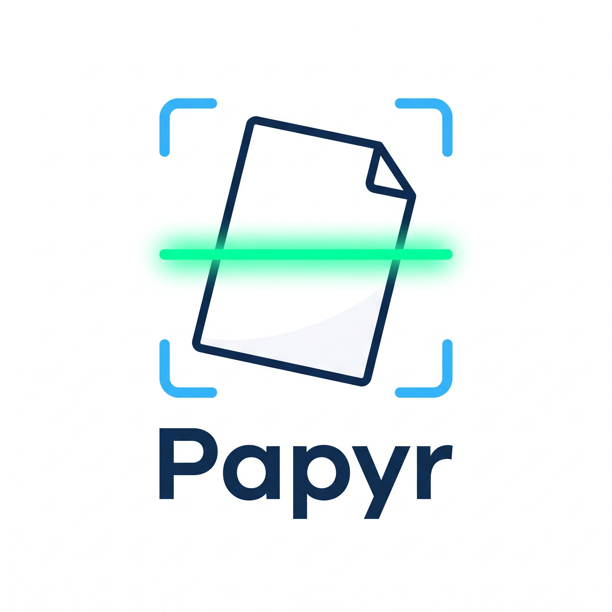

<p align="center">
  
</p>

<p align="center">
  <strong>Scanner de documentos para Android. Offline, sem conta e sem perder resolução.</strong>
</p>

<p align="center">
  
  
  
  
</p>

---

## Sobre

O Papyr fotografa uma ou mais folhas com a câmera do próprio app, detecta o contorno do documento ao vivo, deixa você ajustar os cantos e salva o resultado como **imagens** ou como **um único PDF**, na resolução total da câmera.

Não tem login, não tem nuvem e não pede permissão de internet. Os arquivos ficam na memória pública do aparelho e continuam lá mesmo se o app for desinstalado.

## Recursos

- **Câmera própria** com lanterna, várias fotos por sessão e contorno da folha desenhado sobre o preview.
- **Editor de recorte** com os 4 cantos ajustáveis e rotação em cada foto.
- **Correção de perspectiva** em resolução total, com saída em JPEG qualidade 100.
- **Salvar como Imagens ou PDF.** O PDF tem várias páginas e embute o JPEG sem recompressão.
- **Arquivos:** lista com abrir, visualizar, compartilhar e excluir.
- **Ajustes:** espaço usado por tipo de arquivo e as pastas onde eles ficam.
- **Tema claro e escuro**, seguindo o sistema.

## Como funciona

```
Câmera  ──►  Recorte (4 cantos)  ──►  Salvar (Imagens | PDF)  ──►  Arquivos
  │                                        │
  └─ detecção ao vivo (Dart, isolate)      └─ perspectiva em Kotlin, resolução total
```

| Etapa | Como é feita |
|---|---|
| Detecção do contorno | Dart puro, num isolate, sobre o canal de luminância reduzido para 320 px. Sem OpenCV. |
| Perspectiva | Kotlin: `ImageDecoder` + `Matrix.setPolyToPoly` + `Bitmap.compress(JPEG, 100)`. |
| PDF | Gerador próprio em Dart, página a página, com o JPEG embutido via `/DCTDecode`. |
| Visualizar PDF | `PdfRenderer`, que já vem no Android. |
| Armazenamento | MediaStore, sem pedir permissão de armazenamento. |

A única dependência externa é o pacote [`camera`](https://pub.dev/packages/camera). Navegação, gerador de PDF, detector e visualizadores são código do projeto.

## Onde ficam os arquivos

| Tipo | Pasta |
|---|---|
| Imagens | `Pictures/Papyr` |
| PDFs | `Documents/Papyr` |

Eles aparecem na galeria e no gerenciador de arquivos do aparelho.

## Rodando o projeto

Requisitos: Flutter 3.44 (Dart 3.12) e um aparelho ou emulador Android 11+ (arm64).

```bash
flutter pub get
flutter run                        # roda no aparelho conectado
flutter test                       # testes unitários e de widget
flutter test integration_test      # testes no aparelho (MethodChannel nativo)
flutter build apk --release        # APK só para arm64-v8a
```

## Estrutura

```
lib/
  main.dart            app, tema e barra de navegação
  scan/                câmera, detector, editor de recorte e salvar
  files/               lista de arquivos e visualizadores
  pdf_writer.dart      gerador de PDF
  native.dart          ponte para o Kotlin (MethodChannel "papyr/native")
android/.../MainActivity.kt   perspectiva, MediaStore, PdfRenderer e compartilhar
tool/brand.py          gera ícone, splash e wordmark a partir da logo
docs/superpowers/      specs e planos de design
```

## Limitações conhecidas

- Só Android, só celulares e só em retrato.
- O detector foi validado em imagens sintéticas. Quando ele erra, o editor manual resolve.
- Em 12 MP com JPEG 100, cada página tem de 3 a 15 MB. PDFs grandes podem ser recusados por e-mail ou mensageiros.
- Depois de reinstalar o app, a lista começa vazia. Os arquivos continuam no aparelho, mas o app deixa de ser dono deles.

Os detalhes estão em [`docs/superpowers/specs`](docs/superpowers/specs).
